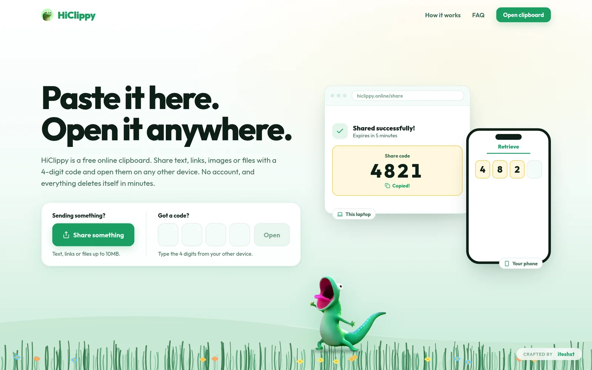
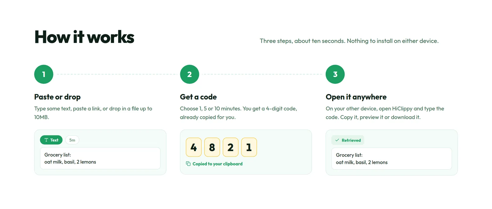
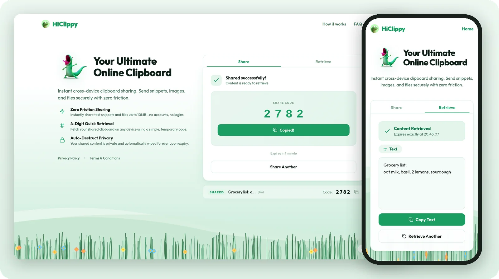
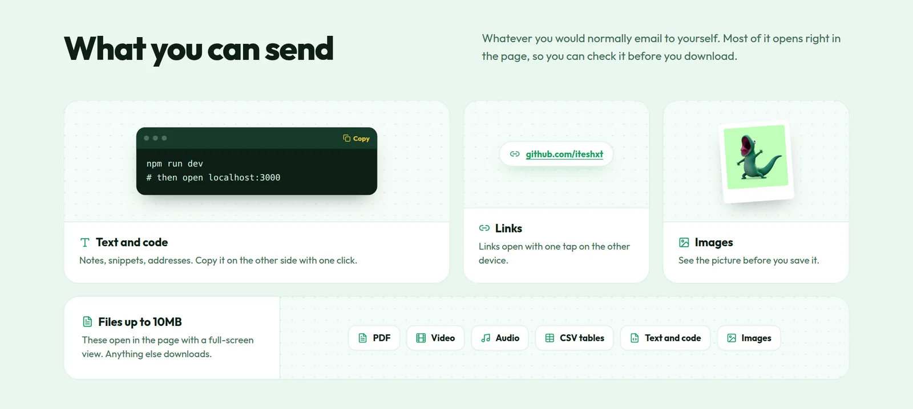
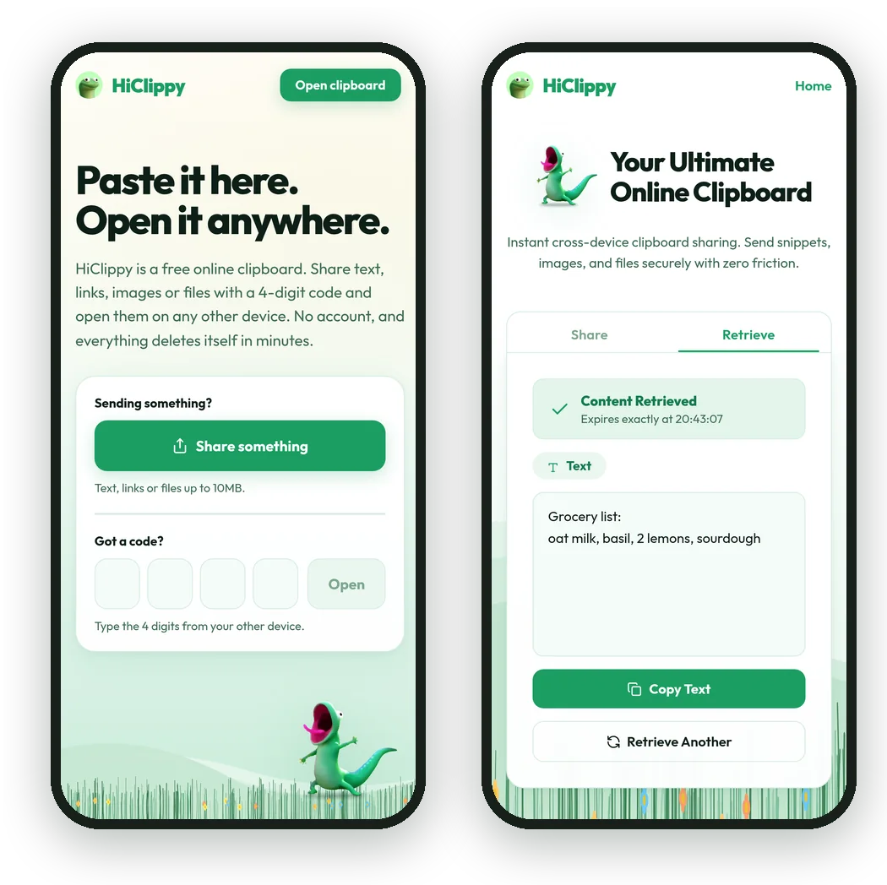
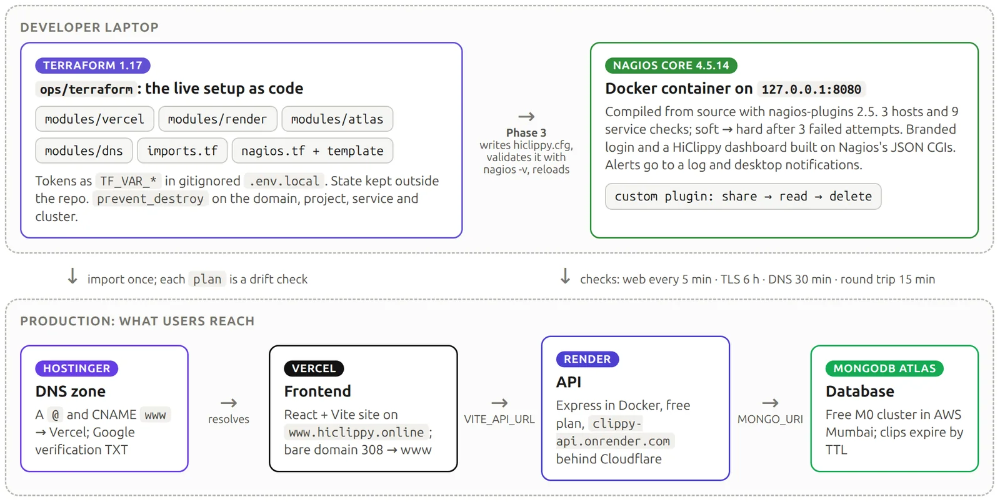
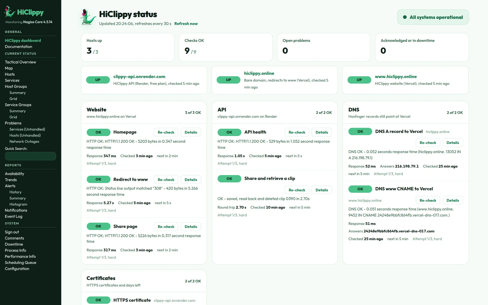

<div align="center">

<a href="https://www.hiclippy.online">
  
</a>

# HiClippy

### Paste it here. Open it anywhere.

A free online clipboard for moving text, links, images and files between your devices with a 4-digit code.<br>
No account, no app to install, and everything deletes itself in minutes.

[**Open HiClippy →**](https://www.hiclippy.online)
&nbsp;·&nbsp; [How it works](#how-it-works)
&nbsp;·&nbsp; [Run it yourself](#run-it-yourself)
&nbsp;·&nbsp; [API](#api)

[](https://www.hiclippy.online)


[](LICENSE)

<br>



</div>

<br>

## Why HiClippy

You found a link on your laptop and need it on your phone. Or a code snippet on a lab PC that you want on your own machine. Emailing yourself, messaging yourself or signing in to a cloud drive is slow, and it leaves copies behind.

HiClippy is the quick way across: paste on one device, type a 4-digit code on the other, done. The clip lives for 1, 5 or 10 minutes and then it is gone for good.

## How it works



1. **Paste or drop.** Type some text, paste a link, or drop in a file up to 10 MB.
2. **Get a code.** Choose 1, 5 or 10 minutes. You get a 4-digit code, already copied for you.
3. **Open it anywhere.** On the other device, open HiClippy and type the code. Copy it, preview it or download it.



## What you can send



| | |
| --- | --- |
| ✍️ **Text and code** | Notes, snippets, addresses. Copy it on the other side with one click. |
| 🔗 **Links** | Open with one tap on the other device. |
| 🖼️ **Images** | See the picture before you save it. |
| 📎 **Files up to 10 MB** | PDFs, video, audio, CSV tables, text and code files and images open right in the page, with a full-screen view. Anything else downloads. |

## Features

- 🔢 **4-digit codes.** Short enough to type on a phone in a few seconds.
- ⏱️ **Self-destructing clips.** Pick 1, 5 or 10 minutes. Expired clips are removed by a MongoDB TTL index, backed up by a cleanup job that runs every minute.
- 👀 **Preview before download.** Images, video, audio, PDFs, text and code files and CSV tables open in the page.
- 🙅 **No accounts.** Nothing to sign up for and nothing to install, on either device.
- 🛡️ **Abuse protection.** Each device gets an anonymous fingerprint (a hash of IP, browser and language). It can upload 5 clips a minute and 20 an hour, and guess 30 wrong codes per 10 minutes.
- 🗑️ **Only you can delete it early.** A clip can be deleted only from the device that shared it.
- 📱 **Built for phones too.** The same flow works on any screen size.

<div align="center">
  
</div>

## Privacy

Clips are meant to be short-lived. They are stored only until they expire, then deleted from the database. There are no accounts, so HiClippy never asks for your name or email. The device fingerprint is a one-way hash used only for rate limits and for knowing who may delete a clip. Read the full [Privacy Policy](https://www.hiclippy.online/privacy) and [Terms](https://www.hiclippy.online/terms).

> Don't use HiClippy for passwords or other secrets: anyone who has the code before the clip expires can open it.

## Under the hood

| Layer | Technology | Runs on |
| --- | --- | --- |
| Frontend | React 18, Vite 6, React Router 7, Framer Motion, Tailwind CSS | [Vercel](https://vercel.com) |
| API | Node.js 22, Express 4, Mongoose 8, Multer, express-rate-limit, node-cron | [Render](https://render.com), in Docker |
| Database | MongoDB (files stored as base64 in the clip document) | [MongoDB Atlas](https://www.mongodb.com/atlas), Mumbai |
| DNS | `hiclippy.online` and `www` pointing at Vercel | Hostinger |
| Infrastructure as code | Terraform: all of the above in four modules | [`ops/terraform`](ops/terraform) |
| Monitoring | Nagios Core 4.5, compiled from source in Docker | [`ops/nagios`](ops/nagios) |



### Infrastructure as code and monitoring

The whole production setup is described in [**Terraform**](ops/terraform/README.md): the Vercel project and domains, the Render service, the Atlas project and cluster, and the DNS records. The live resources were imported without being recreated, so `terraform plan` doubles as a drift check: any change made by hand in a dashboard shows up as a difference. Critical resources are protected with `prevent_destroy`, and no secret is ever stored in Terraform.

[**Nagios**](ops/nagios/README.md) watches the site from the outside:

- the homepage, the share page, the `www` redirect and the API's `/health` (every 5 minutes);
- HTTPS certificates (every 6 hours) and the DNS records (every 30 minutes);
- a custom plugin that shares, reads back and deletes a real clip (every 15 minutes).

A failing check is retried, becomes a confirmed (HARD) problem after 3 failures, and raises a desktop alert. Terraform also generates the Nagios config from its own values, so a change to a domain or DNS record updates the monitoring in the same `terraform apply`.



## Run it yourself

**Requirements:** Node.js 22+ and a MongoDB database (local or Atlas).

```bash
# 1. API
cd backend
cp ../.env.example .env   # then set MONGO_URI
npm install
npm run dev               # http://localhost:3001

# 2. Frontend (in a second terminal)
cd frontend
npm install
npm run dev               # http://localhost:3000
```

The frontend calls the API at `VITE_API_URL` (default `http://localhost:3001`).

**With Docker:** put `MONGO_ROOT_USERNAME` and `MONGO_ROOT_PASSWORD` in a `.env` file next to `docker-compose.yml` (see `.env.example`), then run `docker compose up --build` and open http://localhost:3000. This starts Nginx, the API and MongoDB.

**Tests:**

```bash
cd backend && MONGO_URI=mongodb://localhost:27017 npm test
```

The tests need a running MongoDB. They use a separate `clippy_test` database and drop it when they finish.

<details>
<summary><b>Configuration (API environment variables)</b></summary>

<br>

| Variable | Default | Meaning |
| --- | --- | --- |
| `MONGO_URI` | none | MongoDB connection string |
| `BACKEND_PORT` | `3001` | API port |
| `CORS_ORIGIN` | `http://localhost:3000` | Allowed origins, comma-separated, or `*` |
| `MAX_FILE_SIZE_MB` | `10` | Upload size limit |
| `RATE_LIMIT_BURST_MAX` | `5` | Uploads per minute per fingerprint |
| `RATE_LIMIT_WINDOW_MS` | `3600000` | Window for the hourly limit |
| `RATE_LIMIT_MAX_REQUESTS` | `20` | Uploads per window per fingerprint |
| `PASTE_DEFAULT_EXPIRY_MINUTES` | `60` | Expiry used when none is sent |
| `PASTE_MAX_EXPIRY_MINUTES` | `1440` | Highest expiry the API accepts |
| `LOOKUP_LIMIT_WINDOW_MS` | `600000` | Window for counting wrong codes |
| `LOOKUP_LIMIT_MAX_FAILURES` | `30` | Wrong codes allowed per window per fingerprint |
| `TRUST_PROXY` | `1` | Express `trust proxy` setting: the number of proxy hops in front of the API (1 for the bundled Nginx) |
| `CLIENT_IP_HEADER` | none | Header set by the proxy in front of the API that holds the visitor's IP, used for the fingerprint instead of `req.ip`. **On Render set `cf-connecting-ip`.** Leave it unset anywhere a client could reach the API without going through that proxy (local dev, Docker), or clients could fake their IP. |

**Why Render needs `CLIENT_IP_HEADER`:** requests reach the API through Cloudflare and then Render's proxy. With `TRUST_PROXY=1`, `req.ip` is the Cloudflare edge that connected to Render. That address changes from time to time and many visitors share it, so a clip's owner could get a 404 when deleting it, and rate limits applied per edge instead of per visitor. Cloudflare puts the visitor's IP in `CF-Connecting-IP` and refuses (403) requests where a client sends that header itself, so it can't be faked. Don't use `True-Client-IP`: a client-sent value gets through to the API.

</details>

## API

| Method | Path | Description |
| --- | --- | --- |
| `POST` | `/api/paste` | Multipart or form body: `content` or `file`, `contentType` (`text`, `link`, `image`, `file`), `duration` (minutes). Returns `{ id, expiresAt, expiryMinutes }`. |
| `GET` | `/api/paste/:id` | Returns the clip. Files come back as base64 `content` with `fileName`, `fileSize` and `mimeType`. Add `?meta=1` to leave out `content` for files. |
| `GET` | `/api/paste/:id/raw` | The clip's raw bytes as a download (`Content-Disposition: attachment`, `nosniff`, sandbox CSP). |
| `DELETE` | `/api/paste/:id` | Deletes a clip. Only works from the device that shared it; otherwise returns 404. |
| `GET` | `/health` | Health check: `{ "status": "healthy" }`. |

Expiry is capped by `PASTE_MAX_EXPIRY_MINUTES` (default 1440). The website offers 1, 5 and 10 minutes.

## Project structure

```
hiclippy/
├── frontend/          React + Vite site (landing page, /share, privacy, terms)
├── backend/           Express API: routes, Mongoose model, rate limits, cleanup job, tests
├── ops/
│   ├── terraform/     Production infrastructure as code (Vercel, Render, Atlas, DNS)
│   └── nagios/        Monitoring: Dockerised Nagios, custom plugin, HiClippy dashboard
├── docs/              Ops plan and README images
└── docker-compose.yml Nginx + API + MongoDB for running everything locally
```

## Author

Built by **Itesh Tomar**: [GitHub](https://github.com/iteshxt) · [Website](https://iteshxt.me) · [Email](mailto:mail.iteshxt@gmail.com)

## License

[MIT License](LICENSE). Crafted with ❤️ for a better sharing experience.
